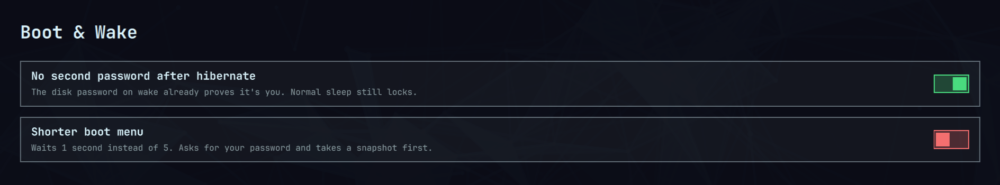

# Boot & Wake

Small fixes for annoying things that happen when your Omarchy laptop starts
up or wakes from sleep. Each fix is a switch you turn on or off. Nothing
changes until you flip one.



## What it fixes

**Typing your password twice after hibernate.** When your laptop wakes from
hibernate, it asks for your disk password, then asks for your password
again at the lock screen. The first one already proves it's you, so this
switch skips the second. Normal sleep still asks for your password as
usual. This only works when your disk is protected by a password you type,
which is how Omarchy sets it up. If your setup is different, the switch
stays off and tells you why.

**Laptop falls asleep on a dock.** If you use your laptop with the lid
closed on a dock or external monitor, it can fall asleep on its own: when
the screen locks and the monitor turns off, and again right after waking
while the dock reconnects. This switch keeps it awake whenever a monitor is
plugged in. Unplug it and close the lid, and it sleeps as normal.

**Waiting at the boot menu.** The menu where you can pick a snapshot waits
5 seconds every time you start up. This switch shortens it, and a slider
lets you pick anywhere from 1 to 4.5 seconds in half-second steps. Sliding
it back to 5 turns the switch off. You can still reach snapshots by pressing an
arrow key while the menu shows. It
asks for your password, and saves a snapshot and a backup copy before it
changes anything.

**Your own boot picture.** Swap the Omarchy logo above the password box
for any theme's logo or one of your own pictures. Put your pictures in the
**Pictures/Boot** folder (the "Add your own" tile opens it). PNG, JPG and
WebP all work. Anything bigger than 800 by 400 pixels, the space the
Omarchy logo uses, is shrunk to fit; a PNG with a transparent background
looks best, because the screen's background colour shows around it. Saving opens a small terminal for
your password, takes a snapshot, and uses Omarchy's own boot screen
command, which takes about a minute.

**How long startup takes.** The panel shows how long your last start took
and how much of it was the boot menu, so you can see what a change saved.

## Install

Run these two lines in a terminal:

```sh
omarchy plugin add https://github.com/cylon58/omarchy-boot-wake.git --enable
omarchy-shell shell summon io.github.cylon58.boot-wake
```

The second line opens the panel. Flip the switches you want, then press
**Save**. Nothing changes until you save. The button is red while you have
unsaved changes and green once they're applied. Saving asks for your
password only when the boot menu changes.

## Turn it off or remove it

Flip a switch off and press Save, and everything it changed goes back the
way it was. To
remove the plugin completely, turn all three switches off first, then run:

```sh
omarchy plugin remove io.github.cylon58.boot-wake
```

## Technical details

For people who want to know exactly what happens. There is also a command
line:

```sh
P=~/.config/omarchy/plugins/io.github.cylon58.boot-wake
$P/bin/boot-wake status
$P/bin/boot-wake enable hibernate-unlock   # or boot-menu, dock-wake
$P/bin/boot-wake enable boot-menu 2.5      # boot menu waits 2.5 seconds
$P/bin/boot-wake disable hibernate-unlock
```

### Safety

**No second password after hibernate** only turns on when it can confirm that
waking from hibernate stops at a typed disk password:

- the hibernation image is on a LUKS-encrypted device, and
- the disk is unlocked by the classic `encrypt` initramfs hook from
  `cryptdevice=`, with no key file (`cryptkey=`, `/crypto_keyfile.bin`, or a
  key in mkinitcpio `FILES`). systemd-based unlocking (`sd-encrypt`,
  `rd.luks`) is refused because it can use TPM or FIDO tokens on its own.
  Every initramfs hook must be on a short list of hooks that cannot unlock a
  disk (so `clevis` and similar are refused), the image must come from
  mkinitcpio's standard config, and
- hibernate really powers off (`HibernateMode` does not keep it in memory).

These checks run again at every hibernate, so a change made since login
counts.

Normal sleep, hybrid sleep and suspend-then-hibernate still lock as before.
It only trusts logind's own announcement (checked by journal fields no other
program can set) of the sleep starting right now, written within the last
three seconds; any other kind of sleep announced alongside it means it locks.
When the machine comes back it confirms with logind that a hibernate really
finished and time really passed; otherwise it locks at once. If it ever loses
its hold on the "lock before sleep" guard, it restarts itself. If it can't tell which kind of sleep is starting (for
example because your user can't read the system journal), it locks. If a
hibernate fails and the session comes straight back, it locks the moment the
machine returns. If you remove the
plugin without turning the fix off, Omarchy's own lock-before-sleep takes over
again automatically.

**Shorter boot menu** asks for your password, then:

1. takes a Snapper root snapshot, and stops if that fails;
2. keeps a copy of `/boot/limine.conf` as `/boot/limine.conf.boot-wake.bak`
   (the boot partition is not covered by snapshots);
3. takes the same boot-partition lock the Limine tools use, changes only the
   `timeout:` line, checks that nothing else differs, and flushes the change
   to disk before reporting success.

It refuses to run when Secure Boot is on or Limine config enrolment
(`ENABLE_ENROLL_LIMINE_CONFIG`) is set, because editing an enrolled config
stops the machine booting. It edits the `limine.conf` on the ESP named by
`ESP_PATH` in `/etc/default/limine` (default `/boot`).

Turning it off puts back the exact original line and removes the backup.
`omarchy refresh limine` resets the whole file to Omarchy's default.

**Stay awake while docked** only holds logind's lid guard while an external
monitor is plugged in (lit or not) or logind says the machine is docked. It
keeps the guard through a sleep, and lets go one minute after waking if the
dock hasn't come back. Unplugging the dock
while awake lets go at once, so a laptop with its lid shut still goes to
sleep. If the laptop is undocked while asleep and wakes in a bag, it sleeps
again within a minute.

### How it works

- The hibernate fix adds a user systemd drop-in,
  `~/.config/systemd/user/omarchy-sleep-lock.service.d/io.github.cylon58.boot-wake.conf`,
  that runs `bin/sleep-monitor` in place of Omarchy's sleep monitor. It holds
  the same delay inhibitor and calls Omarchy's own lock script. The only
  difference is that it reads logind's announcement of the coming sleep from
  the journal and skips the lock when that sleep is a plain hibernate.
- The dock fix installs a user service,
  `~/.config/systemd/user/boot-wake-dock.service`, that runs `bin/dock-guard`.
  It takes a `handle-lid-switch` inhibitor, which needs no admin rights.
- The boot menu fix runs `bin/boot-wake-root` through `pkexec`. It records
  the original timeout line in `/var/lib/boot-wake/`.

Note: like any plugin that uses `pkexec`, the admin step runs a script from
your plugin folder, which your user account can edit.

### Requirements

Omarchy Quattro, `jq`, `python3`, `pkexec`, and Snapper with a `root` config
for the boot menu fix. Your user needs to be able to read the system journal
for the hibernate fix (members of `wheel` can on Omarchy).

### Remove from the command line

Turn the fixes off first, then remove the plugin:

```sh
P=~/.config/omarchy/plugins/io.github.cylon58.boot-wake
$P/bin/boot-wake disable hibernate-unlock
$P/bin/boot-wake disable boot-menu
$P/bin/boot-wake disable dock-wake
omarchy plugin remove io.github.cylon58.boot-wake
```

### Tests

```sh
tests/run.sh       # safety checks and the boot menu editor
tests/monitor.sh   # simulated sleeps through the sleep monitor
tests/dock.sh      # simulated docks and sleeps through the dock guard
```

## License

MIT
